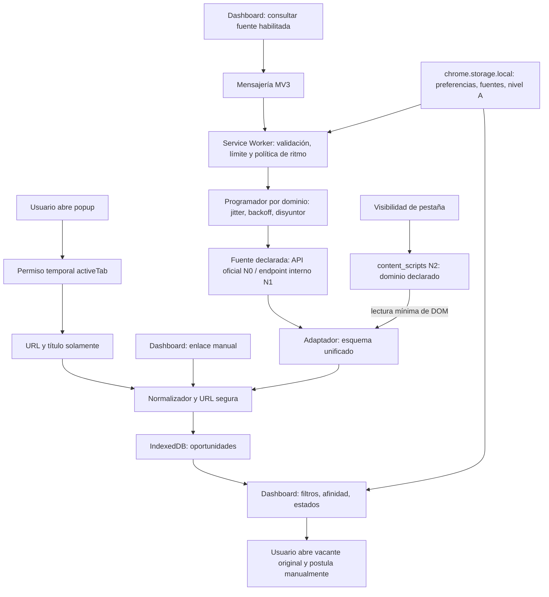

# Arquitectura y contratos — JobScout v0.2.0

## Objetivo y límites

Extensión local-first, sin servidor ni framework. Privacidad por minimización: ninguna API de acceso a cuenta/sesión laboral salvo cuando un conector lo declare explícitamente. El producto gestiona *enlaces a vacantes* y metadatos mínimos; la postulación es manual en el sitio original.

Los conectores se organizan por niveles (N0–N3) según `docs/POLITICA_DE_FUENTES.md`. Todo recurso que roce la identidad del navegador —sesión, cabeceras, ritmo— se declara por conector y es apagable.



## Capas

| Módulo | Responsabilidad | Prohibiciones |
|---|---|---|
| popup | Leer URL/título solo bajo acción de usuario y fuera de portales restringidos, validar, guardar | Nunca inyectar scripts ni leer HTML |
| dashboard | UI, seguimiento, respaldo, ajustes | No ejecutar scripts de contenido externo |
| core | Validación pura, ID por URL canonizada, matching transparente | No acceder a `chrome`, DOM, red |
| storage | IndexedDB: vacantes; storage.local: ajustes | No guardar tokens, CV ni cookies |
| sources | Adaptadores y normalizadores de respuestas oficiales | No endpoints arbitrarios, no HTML activo |
| content |	Solo para conectores N2: lectura mínima del DOM en dominios declarados |	No inyectar estilos, no reescribir la página, no red |
| background | Validar fuente registrada y activa, cooldown, HTTP GET | No consultas periódicas, no cookies ni reintentos automáticos |

## Contrato de oportunidad

```js
{
  id: 'url:https://...', // ID estable por URL canonicalizada
  url: 'https://...',
  title: 'Backend Engineer', company: '...',
  location: '...', description: 'texto simple y acotado',
  salaryText: 'texto de origen, sin convertir',
  remote: true | false | null,
  platform: 'Greenhouse', sourceId: 'uuid-o-manual',
  postedAt: null | 'ISO-8601',
  createdAt: 'ISO-8601', lastSeenAt: 'ISO-8601',
  status: 'new' | 'saved' | 'applied' | 'interview' | 'rejected' | 'archived',
  notes: 'texto privado'
}
```

El identificador actual elimina solo parámetros comunes de seguimiento y fragmentos, **no fusiona** anuncios parecidos de distintas URLs: hacerlo automáticamente podría borrar oportunidades diferentes.

## Cálculo de afinidad

- Coincidencia de algún título buscado: peso 35.
- Tecnologías encontradas en título/descripción: peso 35 (proporción de tecnologías objetivo halladas).
- Preferencia de modalidad remota **o** coincidencia de ubicación: peso 20 cuando existe esa preferencia.
- Fecha reciente: peso 10 cuando la fuente informa fecha.
- El denominador incluye solo criterios configurados y evaluables. La ausencia de salario **no** equivale a incumplir el salario buscado; el salario no entra en el score hasta normalización fiable.
- Las coincidencias por subcadena pueden fallar con abreviaturas, negaciones y falsos positivos. El score es una heurística y necesita explicabilidad, nunca una decisión automática de descartar.

## Política de ritmo (capa anti-ban)
El objetivo es parecer un humano aburrido. Toda la decisión es pura y vive en core/pacing; background solo ejecuta y persiste contadores.

- Esperas con jitter gaussiano. Nunca sleep fijo ni ciclo perfecto. RNG inyectable  para tests deterministas.
- Pacing por dominio, no global. El presupuesto se lleva por host; un host nunca recibe dos peticiones seguidas si hay otro esperando.
- Arranque suave. Las primeras peticiones de una sesión son lentas y suben hasta el presupuesto del nivel A.
- Backoff exponencial con jitter y tope. 401/403/429 => pausa creciente. 5xx => reintento con jitter. Nunca reintento inmediato.
- Disyuntor por dominio. N fallos consecutivos congelan ese dominio; el resto sigue. - Estado y contadores persisten en chrome.storage.session porque el Service Worker muere.
- El nivel A se persiste en chrome.storage.local, nunca en memoria: sobrevive reinicios y es auditable.
- Un 429 devuelve a A0. El ascenso exige sesiones limpias acumuladas, nunca se sube a mitad de sesión.
- Pestaña oculta en N2 => actividad reducida o detenida.

## Modelo de confianza

- Contenido de URLs y respuestas de APIs = no confiable.
- JS usa textContent para valores externos, nunca innerHTML ni eval.
- URLs validadas a HTTPS, sin credenciales, al almacenar y normalizar.
- Los endpoints de consulta no son URLs libres: tienen hosts y rutas fijados por proveedor y slug validado.
- Fetch usa credentials: omit por defecto; include solo si la ficha del conector lo declara y la sesión es imprescindible.
- Redirecciones: redirect: 'follow' con verificación de que response.url mantiene el host declarado; si cambia de dominio, la respuesta se marca y se reporta.
- Límite de tiempo vía AbortSignal y tope de tamaño de respuesta.
- Permisos de host limitados a los dominios declarados en docs/POLITICA_DE_FUENTES.md; nunca <all_urls>.
- chrome.storage.local restringido a TRUSTED_CONTEXTS; IndexedDB solo disponible en origen de la extensión.
- El content_scripts de N2 no inyecta estilos ni modifica el DOM de la página: solo lee.

## Trazabilidad
Cada conector registra nivel, host, peticiones, códigos de respuesta, pausas aplicadas y cambios de nivel A. El log no incluye credenciales ni datos personales.

## Evolución

Al alcanzar 5.000+ ofertas estudiar paginación/cursor de IndexedDB en lugar de getAll. Antes de activar polling aprobarlo por proveedor. Para añadir nuevos ATS: crear adaptador, normalizador, revisión legal, tests de fixture, validación de host y límites de consulta. Evitar un fetch arbitrary url o proxy genérico.

Ninguna fuente sube de nivel A sin datos de trazabilidad que lo respalden. Los proxies siguen siendo escape hatch: se introducen solo si el log demuestra bloqueo sostenido en A0, y nunca como sustituto del pacing.
